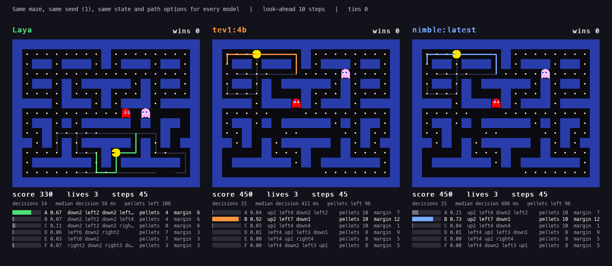
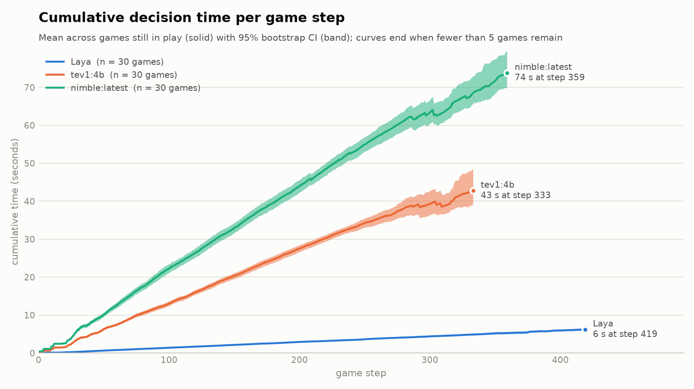
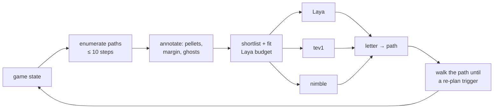

# Pac-Man Decision Arena

**Laya vs tev1 vs nimble: three local decision models play Pac-Man with exactly the same information.**



Each model plays its own copy of the same seeded maze. At every decision all three models get
**character-for-character the same state and the same candidate paths**. Each model receives
them in its own native input format, and each returns one lettered path. Everything runs
locally on an Apple Silicon Mac: Laya on [MLX](https://github.com/ml-explore/mlx), and tev1 and
nimble on [Ollama](https://ollama.com).

- [Results (30 games)](#results-30-games)
- [What is being compared](#what-is-being-compared)
- [Setup](#setup)
- [Running](#running)
- [The game](#the-game)
- [What Pac-Man sees](#what-pac-man-sees)
- [What the models receive](#what-the-models-receive)
- [How a decision is made](#how-a-decision-is-made)
- [Fairness and caveats](#fairness-and-caveats)
- [Outputs and metrics](#outputs-and-metrics)
- [Reproducibility](#reproducibility)
- [Project layout](#project-layout)
- [License](#license)

## Results (30 games)

Laya, tev1:4b and nimble each played seeds 1–30 under identical conditions (default settings,
2000-step cap). The no-model greedy baseline played the same seeds for reference. The raw data is
[`results/20260930_120541_headless/`](results/20260930_120541_headless/): `config.json`, one
decision log per model, and `summary.json`. Reproduce it with:

```bash
python -m pacman_arena --headless --models laya,tev,nimble,greedy --games 30 --seed 1
```

| Model | Mean score (95% CI) | Boards cleared | Mean lives left | Lives lost / 100 steps | Median decision | Mean time per game | Picks the heuristic's top path |
|---|---|---|---|---|---|---|---|
| Laya | 1046 (980–1114) | 0 / 30 | 0.00 | 1.05 | **32 ms** | **4.7 s** | 29% |
| tev1:4b | **1408** (1406–1410) | 27 / 30 | 2.23 | 0.26 | 384 ms | 39.5 s | 52% |
| nimble:latest | **1408** (1405–1410) | 28 / 30 | **2.37** | **0.22** | 668 ms | 66.4 s | 57% |
| *greedy baseline (no model)* | *1410 (1410–1410)* | *30 / 30* | *2.77* | *0.08* | *–* | *0.5 s* | *100%* |

The maximum score is 1410. "Mean time per game" is the total wall-clock time per game, including path analysis on every step.

**Head to head (three models, per seed).** tev1:4b won 18 seeds, nimble 12 and Laya 0. tev1 and
nimble usually both clear the board: only 4 of their 30 matchups were decided by score, 15 by
lives left and 11 by fewer steps.



*Cumulative wall-clock time per game step. The line is the mean over games still in play at that
step, and the band is its 95% bootstrap confidence interval. A curve ends when fewer than 5 games
remain, and small dips near the end appear when a slower game finishes. Regenerate it with
`python -m pacman_arena.plots results/20260930_120541_headless --out docs/cumulative_time.png`.*

**What the numbers say**
- **tev1:4b and nimble play almost identically.** Both average 1408 of 1410 points and clear 90–93% of boards, and their confidence intervals overlap. nimble loses slightly fewer lives but takes about 1.7× longer per decision (668 ms against 384 ms), so a game takes 66 s instead of 40 s.
- **Laya is the fastest by an order of magnitude but plays worst here.** It decides in 32 ms (a whole game in under 5 s), but it lost all 3 lives in every game. It lost lives about 4× as often as the Ollama models and picked the heuristic's top path only 29% of the time.
- **No model beat the heuristic that built the shortlist.** The greedy baseline cleared all 30 boards and lost the fewest lives. With danger and pellets already computed for each path, the choice is largely solved by the features themselves. The models add latency without improving on it. A harder setting would be needed to show a model adding value: raw state, more ghosts, or options without precomputed margins.
- **Every model's input was complete.** There were 0 invalid answers and 0 truncated inputs across all 9,840 model decisions.

These results come from one machine (Apple M4 Max, macOS 26.6.2) and one maze, with 30 seeds per model.

## What is being compared

| Model | Runtime | Size | Exact version used | Returns |
|---|---|---|---|---|
| **Laya** ([`aac6fef/laya-mlx`](https://huggingface.co/aac6fef/laya-mlx)) | `laya-mlx` 0.2.0 on MLX | ModernBERT-large encoder + decision head | HF commit `20aed815fc6acde75733882e7ec0e3f28aeb9717` | calibrated probability per option |
| **tev1:4b** | Ollama 0.35.0 | 4.2B, Q8_0 | digest `cef45ef93cf6…` | one option letter + token log-probs |
| **tev1:0.8b** (optional, `--tev-model tev1:0.8b`) | Ollama 0.35.0 | 0.75B, Q8_0 | digest `d45e875d63fe…` | one option letter + token log-probs |
| **nimble:latest** | Ollama 0.35.0 | 9.0B, Q8_0 | digest `24e550a16a70…` | one option letter + token log-probs |
| **greedy baseline** (optional, `--models …,greedy`) | none | – | [`paths.path_value`](pacman_arena/paths.py) | the highest-scoring path under a fixed heuristic |

The full digests are in [`pacman_arena/models.py`](pacman_arena/models.py). `--check` compares your pulled models against them.

## Setup

Requirements:
- **An Apple Silicon Mac.** laya-mlx runs on MLX. Tested on an M4 Max with macOS 26.6.
- **Python ≥ 3.11.** Tested on 3.14.7.
- **Ollama ≥ 0.35.0.** The tev1 and nimble decision models require it.
- **Disk and memory:** about 16 GB of disk for the models. Running all three at once needs roughly 16 GB of free memory; use `tev1:0.8b` on smaller machines.
- **ffmpeg** (optional) to turn recordings into MP4: `brew install ffmpeg`.

```bash
git clone https://github.com/hakan-gecili/pacman-arena.git && cd pacman-arena
python3 -m venv .venv && source .venv/bin/activate
pip install -r requirements.txt          # or requirements-lock.txt for the exact environment

ollama pull tev1:4b
ollama pull nimble:latest
ollama pull tev1:0.8b                    # optional

python -m pacman_arena --check           # verifies packages, model digests, and downloads the Laya checkpoint
```

`--check` should end with `setup OK`. The first Laya load downloads the pinned checkpoint from
Hugging Face into `~/.cache/huggingface`. Everything after that is local.

## Running

```bash
python -m pacman_arena                                   # live: three boards side by side, Esc/q to quit
python -m pacman_arena --tev-model tev1:0.8b             # use the small tev1
python -m pacman_arena --rounds 3 --record --cell 24     # also save frames + game.mp4 for sharing
python -m pacman_arena --headless --games 20             # the benchmark: every model plays seeds 1..20
python -m pacman_arena --headless --models laya,tev,nimble,greedy --games 20   # add the heuristic baseline
python -m pacman_arena --show-inputs                     # print each model's exact input for one state
python -m pacman_arena --help                            # all options
python -m pacman_arena.plots runs/<run>/                 # cumulative-time chart for a headless run
```

`--models` takes any distinct subset of `laya`, `tev`, `nimble`, `greedy` (for example, `--models laya,tev` for a duel). Each run gets its own folder, such as `runs/20260930_113711_live/` (see [Outputs](#outputs-and-metrics)).

## The game

The game is in [`pacman_arena/game.py`](pacman_arena/game.py). It's a turn-based Pac-Man on a 19 × 15 maze with 141 pellets and two ghosts that start in the top corners.

| Rule | Value |
|---|---|
| Score | +10 per pellet, so the maximum is **1410** |
| Lives | 3. Losing one sends Pac-Man and both ghosts back to their start cells. Eaten pellets stay eaten and the score is kept. |
| Game ends | when all pellets are eaten (**board cleared**), at 0 lives, or at `--max-steps` (default 2000) |
| Speed | Pac-Man moves 1 cell per step. Ghosts move 1 cell on every **second** step. |

**How ghosts move.** On each ghost step, each ghost independently does one of the following:
- **Chase, with probability 0.6:** it takes the legal move that minimizes its maze (BFS) distance to Pac-Man. Ties go to the first move in the order up, down, left, right.
- **Wander, with probability 0.4:** it takes a uniformly random legal move, which may reverse its direction.

All randomness comes from `random.Random(seed)`. The same seed and the same Pac-Man moves always produce the same ghost behaviour.

**Collisions.** Pac-Man moves first. If he steps onto a ghost, he loses a life, and the ghosts don't move that step. Otherwise the ghosts move, and if one lands on Pac-Man he loses a life. As a simplification, a ghost and Pac-Man that swap cells in the same step pass through each other.

## What Pac-Man sees

The models never see the maze grid. Code turns the board into a short list of candidate
**paths** with plain-language facts about each one, and the models choose between those paths.
This is in [`pacman_arena/paths.py`](pacman_arena/paths.py).

1. **Enumerate paths.** Every *simple* path (one that never revisits a cell) of up to `--depth` = 10 steps from Pac-Man's cell. A path ends early at a dead end. From the start cell there are 34 such paths; enumerating them takes a few milliseconds.
2. **Annotate each path:**
   - `pellets`: how many pellets it collects, and the step on which it eats the first one;
   - **`margin`**: worst-case steps to spare before a ghost could reach any cell of the path (defined below). `margin ≤ 0` is **UNSAFE**. In that case the text also names the ghost, the step where it could intercept, and how many pellets are eaten safely before that point;
   - ghosts on the path, the step they occupy, and their motion relative to Pac-Man (`toward you`, `moving away`, `leaving`, `still`);
   - where the path ends: a dead end, or how many exits lead on to a junction;
   - if the path has no pellets, the maze distance from its end to the nearest pellet.
3. **Ghost facts,** for each ghost: position, heading (its last move), maze distance to Pac-Man, trend (`closing in`, `moving away` or `steady`), and which listed paths it sits on (`A@2` means on path A at step 2).

**Margin, precisely.** Pac-Man reaches path cell *i* at step *i* + 1. Ghosts move on even game
ticks, so from tick *t*, a ghost has completed ⌊(*t*+*s*)/2⌋ − ⌊*t*/2⌋ moves after *s*
Pac-Man steps. For each ghost and each path cell, the ghost's *arrival* is the first step *s*
at which that number reaches the ghost's BFS distance to the cell. That is, it assumes the ghost
chases perfectly (real ghosts chase only 60% of the time).

```
margin = min over ghosts, over path cells i of ( arrival(ghost, cell_i) − (i + 1) )
```

## What the models receive

This lives in [`pacman_arena/payload.py`](pacman_arena/payload.py). At a decision, one **payload** is built and every
model gets the same payload: a one-sentence instruction, a state text, and lettered option texts.
Here is a real mid-game payload, from seed 1 at step 23. A ghost two cells away is heading down
path A toward Pac-Man:

```text
rules: +10 per pellet; touching a ghost loses a life; 0 lives is game over; ghosts move 1 cell per 2 Pac-Man steps and mostly chase Pac-Man; margin = steps to spare before a chasing ghost can reach the path, 0 or less is UNSAFE.
strategy: prefer SAFE paths with the most pellets, eaten soonest; avoid dead ends when a ghost is near; if no path has pellets, head toward the nearest pellet.
pacman (4, 9); score 230; lives 3; pellets left 118; last move up; ghosts move next step: yes
G0 (4, 7) heading down, distance 2, closing in, on paths A@2
G1 (17, 4) heading down, distance 18, closing in, on paths none
A) up6 left3 up1; 10 pellets from step 1; UNSAFE margin -2 (G0 at step 2), 1 safe pellets; G0 on it at step 2 toward you; ends with 1 exit
B) down2 left3 down2 right3; 0 pellets; SAFE margin 4; ends with 1 exit; nearest pellet 5 further
C) right8 up2; 6 pellets from step 1; SAFE margin 4; ends with 2 exits
D) right8 down2; 6 pellets from step 1; SAFE margin 4; ends with 1 exit
E) right10; 6 pellets from step 1; SAFE margin 4; ends with 2 exits
```

Coordinates are (x, y), with x increasing to the right and y increasing downward. `up6 left3 up1` means 6 steps up, then 3 left, then 1 up.

**The same payload in each model's native format.** Only the wrapper differs:

| Model | Wrapper ([`models.py`](pacman_arena/models.py)) |
|---|---|
| Laya | `agent.predict(state, {"path": {"type": "choice", "instructions": <instruction>, "criteria": {"A": <option A>, …}}})` |
| tev1 | `Task: <instruction>` / `State:` <state> / `Options:` `A) …` / `Answer:`, a decision-task layout matching its built-in "select exactly one listed option, return only its letter" instructions |
| nimble | `Context:` <state> / `Schema:` `field: path - <instruction>` / `choices:` `A: …` / `Requested field: path` / `Answer:`, matching its built-in "classify the context using the schema, return the one-letter code" instructions |

Run `python -m pacman_arena --show-inputs` to print all three inputs for a state, along with each model's answer.

**How options are chosen, and why Laya's token budget matters for everyone.** The Laya
checkpoint *silently truncates* its input. The instruction plus all options must fit in 192
tokens, each option in 48 tokens, and the whole input in 512 tokens. To make sure no model sees
more than another:

1. **Rank.** Every path gets a heuristic `value`: 10 × safe pellets, minus 0.5 × the step of the first pellet, a bonus for margin, and penalties for unsafe paths and dead ends near ghosts. For each first move (up, down, left, right), keep the best-valued path, the safest path and the next best, dropping near-duplicates. That gives at most 10 paths.
2. **Fit.** Using Laya's own tokenizer, [`LayaBudget`](pacman_arena/payload.py) mirrors `laya_mlx`'s input construction. It uses terser wording for any option over 48 tokens, and drops the lowest-valued option until nothing would be truncated. In practice each decision shows 3–7 options.
3. **Share.** tev1 and nimble get exactly this fitted list, even though their context windows could hold more.

Options are lettered in up, down, left, right order, not by value, so letter A is not a hint.
The one-sentence instruction and the strategy line in the state are the only guidance any model gets.

## How a decision is made

This is in [`pacman_arena/pilot.py`](pacman_arena/pilot.py).



1. **Ask.** The model returns a probability for each option letter:
   - *Laya:* the calibrated softmax over options from its decision head.
   - *tev1, nimble:* the first generated token's top-20 log-probabilities, restricted to the valid letters and renormalized. Decoding uses `temperature 0` and `seed 0`, so the generated letter is the most likely one.
2. **Pick.** The model's letter selects the path. If an answer can't be parsed, the heuristic's best path is used instead and the answer is counted in `invalid_answers`; none occurred in testing.
3. **Walk.** Pac-Man follows the chosen path and asks again only when one of these happens:
   - the path is finished;
   - he reaches a junction (3 or more exits);
   - the rest of the path's margin drops to `--danger-margin` = 1 or below;
   - he loses a life.

   `--replan step` asks on every step instead.

The window shows the candidate paths in grey and the chosen path in the model's colour. Under each
board, bars show the model's probability for each option.

## Fairness and caveats

What is identical for every model:
- the seed and maze;
- the state text, option texts and letters, all fitted so Laya truncates nothing (`truncated_decisions` in the summary should be 0);
- the re-planning rules and step cap;
- a warm-up call before the first measurement, so model loading doesn't count as decision time.

What to keep in mind when reading the results:
- **The games diverge.** All boards start identical, but after the first different choice the positions differ, and so do the ghosts' random draws. Compare models over many seeds; the headless mode pairs results by seed.
- **The code does the planning.** Path search, danger estimates and shortlisting are deterministic code. The models choose between pre-analysed options, so this measures decision quality given good features, not spatial reasoning.
- **The shortlist is heuristic.** The best possible move may not be among the options. The `greedy` baseline, which picks the shortlist's top-valued path, shows how much a model adds over the heuristic that built the shortlist.
- **Latency depends on the model and runtime.** Laya is an encoder on MLX, while tev1 and nimble are generative models served by Ollama. In the live view all boards advance together, one step per frame, so faster models don't get more moves. The median decision time is shown per model.

## Outputs and metrics

Every run creates `runs/<YYYYmmdd_HHMMSS>_<live|headless>/` (use `--out` for a different parent folder):

| File | Contents |
|---|---|
| `config.json` | command line, settings, model identifiers with Ollama digests and the Laya revision, the exact instruction and rules text, and the Python, package and platform versions |
| `<model>.csv` | one row per step: re-plan reason, options with probabilities, chosen letter and path, move, score and lives, model latency (`latency_ms`), wall-clock time for the whole step (`step_ms`), token count, and the exact prompt on decision steps |
| `summary.json` | per-model metrics and head-to-head wins |
| `rounds.csv` | live mode only: one row per round with each model's result and the winner |
| `frames/`, `game.mp4` | live mode with `--record` |

Summary metrics per model: `mean_score` (with a 95% bootstrap CI), `board_clear_rate`,
`mean_lives_left`, `lives_lost_per_100_steps`, `mean_steps`, `mean_game_seconds`, `decisions`, and
`decision_latency_median_ms` / `decision_latency_p95_ms`. Also `invalid_answers`,
`agreement_with_greedy` (how often the model picked the heuristic's top path),
`max_input_tokens` and `truncated_decisions`.

A round is won by the highest score, then the most lives left, then the fewest steps. If the best result is shared, the round is a tie.

## Reproducibility

- **Pinned software:** `requirements.txt` pins the direct dependencies, and `requirements-lock.txt` is the full `pip freeze` of the environment used.
- **Pinned models:**
  - Laya is loaded at a fixed Hugging Face commit (`--laya-revision`).
  - The Ollama models are identified by manifest digest. `--check` reports whether yours match, and each run records the digests it used in `config.json`.
- **Deterministic runs:** the game is seeded, Laya inference is deterministic, and Ollama decoding uses `temperature 0` and `seed 0`. Re-running the same command on the same machine reproduces the same scores. This was verified by re-running from a fresh virtual environment.
- **Caveat:** a different chip, MLX build or Ollama build can change floating-point results slightly. That can flip a close decision, after which the game diverges.

Tests cover the game rules, ghost timing, path enumeration and payload construction, and don't need any models:

```bash
pip install -r requirements-dev.txt && pytest -q
```

## Project layout

```text
pacman_arena/
  game.py      maze, rules, ghost behaviour (seeded)
  paths.py     path enumeration, margin/danger analysis, heuristic value, shortlist
  payload.py   the shared model input and Laya token-budget fitting
  models.py    Laya / Ollama (tev1, nimble) / greedy adapters and native input formats
  pilot.py     plan following and re-planning
  render.py    pygame sprites and boards
  stats.py     decision logs and summary metrics
  plots.py     cumulative-time chart from a headless run
  arena.py     command line: live, headless, --show-inputs, --check
tests/         model-free tests
results/       the published 30-game run (config, decision logs, summary)
docs/          screenshot and charts
```

## Credits

- [Laya-MLX](https://github.com/mizorewww/laya-mlx) (Apache-2.0): MLX port of [Laya](https://github.com/NandhaKishorM/laya) typed decision models; weights at [`aac6fef/laya-mlx`](https://huggingface.co/aac6fef/laya-mlx).
- The tev1 and nimble models are distributed through Ollama under the Apache-2.0 license, as listed by `ollama show`.
- Pac-Man is a trademark of Bandai Namco Entertainment. This is an independent, non-commercial research demo.

## License

[MIT](LICENSE) © 2026 Hakan Gecili. Third-party models and libraries keep their own licenses (see Credits).
